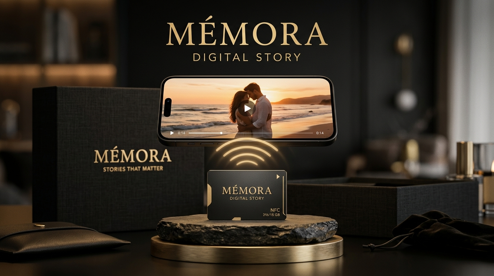

# Welcome to M2MORA 🖤

**Preserving Human Memories Through Tangible Craft & Connected Technology.**  
*Basé en Tunisie 🇹🇳 — Fièrement façonné pour le monde.*

---

### 🌟 About M2MORA

At **M2MORA**, we bridge the gap between tangible sentiment and modern digital storytelling. We design physical memory keepsakes (smart NFC photo cards, heirloom boxes, and ambient photo frames) that trigger unforgettable personal digital memories with a single phone tap.

### 🚀 Active Repositories & Initiatives

- **[`memora-digital-story`](https://github.com/M2MORA/memora-digital-story)**: The core monorepo containing:
  - 🛍️ **Consumer Storefront & Interactive Studio** (TanStack Router, React 19, Tailwind CSS).
  - 🎞️ **Immersive Memory Player** (Zero-app NFC / QR playback experience).
  - 🛡️ **Fulfillment Admin Dashboard** (Order processing, batch NFC encoder, Supabase real-time sync).

---

### 🛠️ Tech Stack & Standards

- **Frontend**: React 19, TypeScript, TanStack Router, Vite, Tailwind CSS v4, Lucide Icons, Radix UI.
- **Backend & Cloud**: Supabase (PostgreSQL, Storage, Realtime, RLS Policies).
- **Hardware Integration**: NXP NTAG213 / NTAG215 NFC chips, encoded high-durability smart PVC / bamboo cards.
- **Testing & Quality**: Vitest, ESLint, Prettier.

---

### 👥 For Team Members & Collaborators

1. Check out our **[Architecture Documentation](https://github.com/M2MORA/memora-digital-story/blob/main/ARCHITECTURE.md)** to understand how physical NFC cards link to digital capsules.
2. Read the **[Contribution Guidelines](https://github.com/M2MORA/memora-digital-story/blob/main/CONTRIBUTING.md)** for branch names, code review etiquette, and commit formats.
3. Keep all private keys and credentials safe — never commit `.env` files.

---

  © 2026 M2MORA. All rights reserved. • Make Memories Last.

