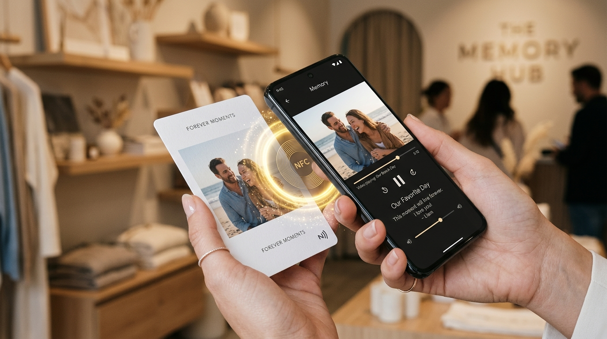
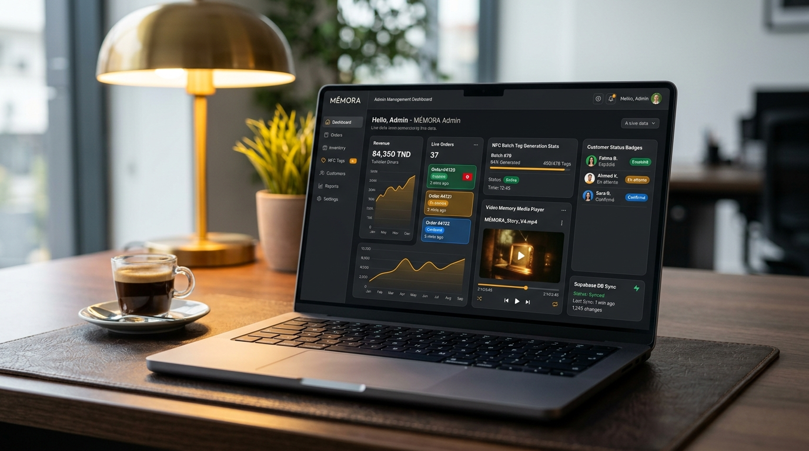
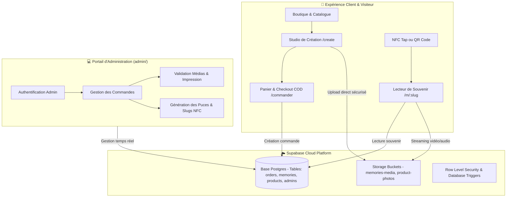

<div align="center">


# MÉMORA — Digital Story

**Where Physical Keepsakes Meet Digital Emotion via Seamless NFC & QR Technology.**  
*Conçu avec passion en Tunisie 🇹🇳 pour immortaliser les souvenirs qui comptent.*

[](https://react.dev/)
[](https://www.typescriptlang.org/)
[](https://tanstack.com/router)
[](https://vitejs.dev/)
[](https://supabase.com)
[](https://tailwindcss.com/)
[](https://vitest.dev/)

[Explore Storefront](http://localhost:8080) • [Admin Dashboard](./admin) • [Team Guidelines](#-guide-de-collaboration-pour-léquipe) • [Architecture](#-architecture-technique) • [Documentation API & DB](#-base-de-données-supabase)

</div>

---

## 📖 Vision & Concept

**MÉMORA** réinvente le souvenir physique. Nous transformons de précieux moments (photos de mariage, naissances, voyages, anniversaires, messages d'amour) en objets tactiles luxueux — cartes mémo ultra-fines, tirages rétro, coffrets cadeaux et cadres connectés.

Chaque objet physique intègre une **puce NFC invisible** et un **QR code de secours**. Un simple contact avec n'importe quel smartphone moderne (iOS ou Android) ouvre instantanément l'histoire numérique privée du souvenir : **vidéo haute définition, piste audio émotionnelle, lettre manuscrite numérique et galerie photo**, le tout **sans aucune application à installer**.

---

## ✨ L'Expérience Utilisateur en Images

<div align="center">
  
  <p><em>Tap NFC instantané : du toucher de la carte physique à la lecture immédiate du souvenir vidéo.</em></p>
</div>

### Ce qui rend MÉMORA unique :
- ⚡ **Expérience Zero-App** : Pas d'application à télécharger sur l'App Store ou Google Play. La technologie NFC web native déclenche directement le navigateur.
- 🎬 **Studio de Création Personnalisée** : Téléversement de vidéos lourdes via chunking resumable (TUS), découpage d'extraits, générateur d'arrêt sur image (*Frame Scrubber*) pour impression photo haute fidélité.
- 🇹🇳 **100% Adapté au Marché Tunisien** : Monnaie en Dinars Tunisiens (TND), tarification dynamique avec remises sur quantité (1, 2, 3+ cartes), livraison Cash on Delivery (COD) sur toute la Tunisie (Grand Tunis, Sahel, Sfax, Cap Bon, etc.) et support direct via WhatsApp flottant.
- 🛡️ **Confidentialité & Sécurité** : Les souvenirs peuvent être protégés par code PIN personnel, avec stockage sécurisé et politiques RLS (Row Level Security).

---

## 🖥️ Plateforme d'Administration & Gestion

<div align="center">
  
  <p><em>MÉMORA Admin Suite : Supervision des commandes en temps réel, génération des puces NFC, validation vidéo et métriques.</em></p>
</div>

Le projet comprend un portail d'administration complet dédié à l'équipe opérationnelle :
- 📦 **Traitement des commandes** : Pipeline de statuts (`En attente` ➔ `Confirmé` ➔ `En fabrication` ➔ `Expédié` ➔ `Livré`).
- 🏷️ **Gestion des Puces NFC & Liens** : Association des identifiants physiques de cartes aux souvenirs numériques (`/m/:slug`).
- 📊 **Tableau de bord financier** : Suivi des ventes, revenus globaux en TND, panier moyen et taux de conversion.
- 🗄️ **Visualisation des médias clients** : Contrôle qualité des photos à imprimer et des vidéos avant impression et expédition.

---

## 🏛️ Architecture Technique



---

## 📂 Structure du Répertoire

```text
memora-digital-story/
├── .agents/                 # Configurations MCP & compétences d'IA
├── admin/                   # 🛡️ Portail d'administration complet (Vite + React 19)
│   ├── src/
│   │   ├── components/      # Composants Dashboard, Login, Tableaux de commandes
│   │   ├── lib/supabase.ts  # Client Supabase pour l'espace admin
│   │   └── App.tsx          # Router et état d'authentification admin
│   ├── index.html
│   └── package.json
├── docs/                    # 📚 Documentation & Médias
│   └── assets/              # Bannières, mockups et diagrammes du projet
├── public/                  # Fichiers statiques, favicon, robots.txt
├── src/                     # 🛍️ Application principale Storefront & Memory Viewer
│   ├── assets/              # Photographies de produits, packaging, démos
│   ├── components/          # Composants UI réutilisables
│   │   ├── site/            # Composants vitrine (Header, Footer, TapDemo, WhatsApp, etc.)
│   │   └── ui/              # Composants Radix UI / Design System
│   ├── lib/
│   │   ├── cart.ts          # Store réactif local du panier d'achat
│   │   ├── pricing.ts       # Calcul des remises par volume et frais de port
│   │   ├── products.ts      # Définition du catalogue physique MÉMORA
│   │   └── supabase.ts      # Client Supabase client-side
│   ├── routes/              # Routes TanStack Router
│   │   ├── __root.tsx       # Layout racine avec navigation & footer
│   │   ├── index.tsx        # Page d'accueil héro avec animations et démonstrateurs
│   │   ├── shop.tsx         # Catalogue des produits
│   │   ├── create.$productId.tsx # Studio de personnalisation & scrubber vidéo
│   │   ├── commander.tsx    # Page de finalisation de commande express COD
│   │   ├── m.$memorySlug.tsx# Page immersive du souvenir numérique (/m/:slug)
│   │   └── espace-entreprise.tsx # Offres B2B & cadeaux d'entreprise
│   ├── styles.css           # Thème global et tokens CSS
│   └── routeTree.gen.ts     # Arborescence de routes générée automatiquement
├── supabase/                # 🐘 Scripts SQL & Schémas de base de données
│   ├── schema.sql           # Tables, colonnes, contraintes, RLS
│   └── admin.sql            # Politiques et rôles d'administration
├── package.json             # Dépendances et scripts de l'application client
└── README.md                # Documentation principale du projet
```

---

## 🚀 Guide de Démarrage Rapide

### 1. Prérequis
- **Node.js** : version 18 ou supérieure recommandée (`node -v`)
- **npm** ou **bun**
- Un compte **[Supabase](https://supabase.com)** avec un projet configuré

---

### 2. Cloner le Projet

```bash
git clone https://github.com/M2MORA/memora-digital-story.git
cd memora-digital-story
```

---

### 3. Configuration des Variables d'Environnement

Créez un fichier `.env` à la racine pour la boutique client :

```bash
cp .env.example .env
```

Remplissez votre `.env` avec les identifiants de votre projet Supabase :
```ini
VITE_SUPABASE_URL=https://votre-projet.supabase.co
VITE_SUPABASE_ANON_KEY=votre-cle-anon-publique
```

Faites de même pour le sous-dossier `admin/` :
```bash
cp admin/.env.example admin/.env
```

---

### 4. Lancer la Boutique Principale (Storefront)

```bash
# Installer les dépendances
npm install

# Démarrer le serveur de développement
npm run dev
```
La boutique client s'ouvrira sur **[http://localhost:8080](http://localhost:8080)**.

---

### 5. Lancer le Portail Admin

Ouvrez un second terminal :

```bash
cd admin
npm install
npm run dev
```
Le tableau de bord d'administration sera disponible sur **[http://localhost:5173](http://localhost:5173)** (ou le port indiqué par Vite).

---

## 🐘 Base de Données Supabase

Les scripts SQL complets sont versionnés dans le dossier `supabase/` :

1. Rendez-vous sur votre **Supabase Dashboard** ➔ **SQL Editor**.
2. Exécutez le script **[`supabase/schema.sql`](./supabase/schema.sql)** :
   - Crée les tables : `orders`, `order_items`, `memories`, `products`.
   - Configure les buckets de stockage pour les vidéos et images.
   - Active les règles de sécurité RLS (*Row Level Security*).
3. Exécutez **[`supabase/admin.sql`](./supabase/admin.sql)** pour configurer les permissions du compte administrateur.

---

## 🛠️ Scripts NPM Disponibles

| Commande | Dossier | Rôle |
| :--- | :--- | :--- |
| `npm run dev` | Racine | Démarre l'application client TanStack Start |
| `npm run build` | Racine | Compile l'application pour le déploiement |
| `npm run test` | Racine | Lance la suite de tests unitaires (Vitest) |
| `npm run lint` | Racine | Vérifie la conformité du code avec ESLint |
| `npm run format` | Racine | Formate automatiquement les fichiers avec Prettier |
| `npm run dev` | `admin/` | Démarre le tableau de bord d'administration |
| `npm run build` | `admin/` | Compile le portail admin |

---

## 👥 Guide de Collaboration pour l'Équipe

Bienvenue aux développeurs et contributeurs de l'organisation **M2MORA** ! Pour maintenir un standard de code irréprochable :

### 1. Stratégie de Branches
- `main` : Branche de production protégée, toujours stable et déployable.
- `feat/nom-fonctionnalite` : Pour toute nouvelle fonctionnalité (ex: `feat/checkout-validation`).
- `fix/nom-du-bug` : Pour les résolutions d'anomalies (ex: `fix/video-scrubber-safari`).
- `docs/mise-a-jour` : Pour les enrichissements de documentation.

### 2. Norme des Commits (Conventional Commits)
Utilisez des messages explicites :
- `feat: ajouter le calcul automatique des frais de port pour le sud tunisien`
- `fix: corriger l'orientation portrait de la vidéo dans le lecteur /m/:slug`
- `docs: enrichir le guide d'installation admin`
- `refactor: simplifier le store local du panier cart.ts`

### 3. Check-list avant Pull Request
- [ ] Le code compile sans avertissement (`npm run build`).
- [ ] Les tests passent avec succès (`npm run test`).
- [ ] Aucune variable secrète ou clé privée n'est commitée (vérifier que `.env` reste ignoré).
- [ ] La page `/m/:slug` reste 100% immersive (sans navbar/footer parasite).

---

## 📞 Support & Contact

- **Organisation GitHub** : [@M2MORA](https://github.com/M2MORA)
- **Dépôt Officiel** : [M2MORA/memora-digital-story](https://github.com/M2MORA/memora-digital-story)
- **Localisation** : Tunisie 🇹🇳

<div align="center">
  <sub>Fait avec cœur par l'équipe MÉMORA • Make Memories Last 🖤</sub>
</div>
